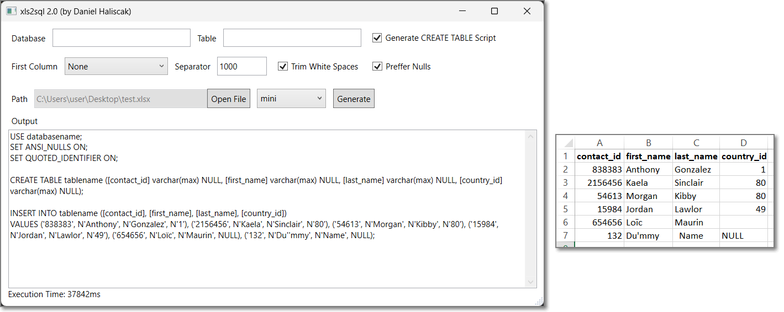

# xls2sql
Do you have data in spreadsheet and you need to quickly create INSERT script? Perhaps you will find this tool usefull.

# About app
- C#
- WPF
- .NET 8.0 and .NET Framework 4.8 (multi-targeting)

# Download
Download content of following folder https://github.com/dhaliscak/xls2sql/tree/main/download and run .exe file
- `download/.net 8.0/v3.2` - requires .NET 8 Desktop Runtime
- `download/.net 4.8/v3.2` - runs on .NET Framework 4.8 (included in Windows 10/11)

# Changelog
## v3.2
- dark / light mode: follows Windows app mode by default (also when changed while app is running)
- theme toggle button in top-right corner: Windows -> Light -> Dark (not saved, every start follows Windows)
- dark title bar in dark mode (Windows 10 20H1+ / Windows 11)

## v3.1
- upgraded from .NET 5.0 to .NET 8.0 (.NET Framework 4.8 build still available)
- replaced ExcelDataReader with Sylvan.Data.Excel / Sylvan.Data.Csv (faster reading, added .xlsb support)
- CSV: auto-detected delimiter, Windows-1250 fallback encoding
- Excel dates exported as ISO 8601 (`2024-03-07T13:05:00`, `2024-12-31` for date-only)
- sheet is loaded in background right after selection and cached
- SQL generated in parallel, output kept as UTF-8 chunks (half the memory, no 2 GB limit for huge scripts)
- new virtualized output viewer: instant display and scrolling of very large scripts, mouse selection, Ctrl+C, Ctrl+A, context menu
- added "Copy All" button next to Output label
- Save streams output to file without building one big string
- memory released after each generate

## v3.0
- improved built logic, no more duplicated code, instead doing Multi-targeting

## v2.4
- AI optimized code

## v2.3
- Added Save button to save output query to txt file instead of printing on UI

## v2.2
- fixed: cell value starting with apostrophe
- fixed: empty header value

## v2.1
- added option to drag & file

## v2.0
- added .NET Framework 4.8 project as it by default in Windows (if you don't want to install .NET 5, you can try .NET Framework 4.8 first)

## v1.2
- Removed settings from config file and added them on UI
- Added "First Column" setting
- Improved performance (read of 100k records from 342sec to 5sec)
- Added metric stats to status bar
- Re-sizable window

## v1.1
- new feature: added config file with ability to change batch size (default 1000), prefer nulls (default true), trim whitespaces (default true)
- fixed: replacing "new line" character in name of columns

## v1.0
- initial release
- ability to choose between workbook if spreadsheet contains more of them
- ability to generate script for "CREATE TABLE"
- ability to enter your own database name and table name before generating script

